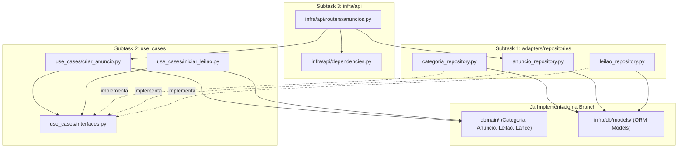

## Mensagem 1 — Usuário

A partir dessa branch, crie um planejamento para a implementação das outras subtasks minhas. Mas agora crie somente os testes, pergunte o necessário, quero implementar com práticas de TDD

## Mensagem 2 — Assistente

> **Ferramenta:** `Glob` — glob_pattern: **/*
> **Ferramenta:** `Read` — path: README.md
> **Ferramenta:** `Read` — path: tests/integration/test_catalogo_models.py
> **Ferramenta:** `Shell` — command: git status && git branch -a && git log -n 5 --oneline
> **Ferramenta:** `Read` — path: docs/responsabilidades-equipe.md
> **Ferramenta:** `Read` — path: docs/proximos-passos.md
> **Ferramenta:** `Read` — path: docs/notas-pessoais/Caio/roteiro-geral-pos-fastapi.md
> **Ferramenta:** `Read` — path: docs/notas-pessoais/Caio/infra-db-models-catalogo.md
> **Ferramenta:** `Read` — path: domain/categoria.py
> **Ferramenta:** `Read` — path: domain/anuncio.py
> **Ferramenta:** `Read` — path: domain/leilao.py
> **Ferramenta:** `Read` — path: domain/lance.py
> **Ferramenta:** `Read` — path: domain/exceptions.py
> **Ferramenta:** `Read` — path: use_cases/interfaces.py
> **Ferramenta:** `Read` — path: use_cases/cadastrar_usuario.py
> **Ferramenta:** `Read` — path: tests/unit/test_cadastrar_usuario.py
> **Ferramenta:** `Read` — path: docs/arquitetura.md
> **Ferramenta:** `Read` — path: docs/must-read.md
> **Ferramenta:** `Read` — path: infra/db/models/__init__.py
> **Ferramenta:** `Read` — path: infra/db/models/categoria.py
> **Ferramenta:** `Read` — path: infra/db/models/anuncio.py
> **Ferramenta:** `Read` — path: infra/db/models/leilao.py
> **Ferramenta:** `Read` — path: infra/db/models/lance.py
> **Ferramenta:** `Read` — path: infra/api/app.py
> **Ferramenta:** `Read` — path: pyproject.toml

Escopo do Planejamento TDD das Subtasks de Catalogo

Qual deve ser o escopo dos testes que vamos criar agora (fase Red do TDD)?

- Planejar todas as 3 subtasks (Repositories -> Use Cases -> API Routes) e escrever a bateria de testes (Red) para elas (Recomendado)
- Planejar a visao geral das 3 subtasks, mas escrever agora somente os testes da proxima subtask imediata (Repositories)
- Escrever agora os testes de Repositories e Use Cases (CriarAnuncio e IniciarLeilao), deixando API Routes para depois do Auth do Teo

Nos casos de uso (CriarAnuncio e IniciarLeilao), como voce prefere modelar o fluxo de criacao de anuncio com leilao?

- CriarAnuncio ja cria o Leilao opcionalmente (quando tipo=LEILAO) e associa ao anuncio na mesma operacao (Recomendado)
- CriarAnuncio cria apenas o Anuncio, e a configuracao/abertura do Leilao fica em IniciarLeilao (ou CriarLeilao)

## Mensagem 3 — Usuário

Escopo dos testes: Planejar todas as 3 subtasks (Repositories -> Use Cases -> API Routes) e escrever a bateria de testes (Red) para elas.

Fluxo de criação: CriarAnuncio já cria o Leilão opcionalmente (quando tipo=LEILAO) e associa ao anúncio na mesma operação.

## Mensagem 4 — Assistente

Contratos de Repositorio e API para os Testes TDD

Na subtask de Repositories e no caso de uso CriarAnuncio, devemos incluir um CategoriaRepository para validar se a categoria existe e esta ativa no dominio?

- Incluir CategoriaRepository (buscar_por_id, listar_ativas, salvar) e validar em CriarAnuncio se a categoria existe e esta ativa (Recomendado)
- Apenas AnuncioRepository e LeilaoRepository (confiar na FK do banco para categoria_id)

Para os testes de API (POST /anuncios e GET /anuncios), como voce prefere lidar com a identificacao do vendedor enquanto o PR de JWT do Teo nao esta integrado?

- Usar uma dependencia FastAPI injetavel (ex.: get_current_user / get_vendedor_atual) que pode ser sobrescrita via dependency_overrides nos testes (Recomendado)
- Receber vendedor_id diretamente no payload ou header (ex.: X-User-Id) ate o PR de JWT do Teo entrar

## Mensagem 5 — Usuário

Repositório de categoria: Incluir CategoriaRepository (buscar_por_id, listar_ativas, salvar) e validar em CriarAnuncio se a categoria existe e está ativa.

Autenticação na API: Usar uma dependência FastAPI injetável (ex.: get_current_user / get_vendedor_atual) que pode ser sobrescrita via dependency_overrides nos testes.

## Mensagem 6 — Assistente

> **Ferramenta:** `Read` — path: Jenkinsfile
> **Ferramenta:** `Read` — path: docs/hierarquia-excecoes.md
> **Ferramenta:** `Read` — path: docs/estrutura-e-stack.md
> **Ferramenta:** `CreatePlan` — name: Planejamento TDD Subtasks Catalogo

# Planejamento TDD — Subtasks de Catalogo e Gestao de Leiloes

Este plano organiza as **3 subtasks restantes** do seu escopo (`adapters/repositories`, `use_cases` e `infra/api`) a partir da branch atual `feature/infra-db-models-catalogo` (onde os models `CategoriaModel`, `AnuncioModel`, `LeilaoModel` e `LanceModel` ja estao implementados e testados em [`tests/integration/test_catalogo_models.py`](tests/integration/test_catalogo_models.py)).

Seguindo o fluxo **TDD (Red -> Green -> Refactor)** e sua instrucao, **nesta execucao criaremos exclusivamente as suites de testes** que especificam os contratos e comportamentos esperados de cada camada.

---

## Visao Geral do Fluxo e Camadas



---

## Subtask 1 — Repositories de Catalogo (`feature/adapters-repositories-catalogo`)

### Contratos Esperados (em [`use_cases/interfaces.py`](use_cases/interfaces.py) e `adapters/repositories/`)

- **`CategoriaRepository`** (`adapters/repositories/categoria_repository.py` -> `SQLAlchemyCategoriaRepository`):
  - `salvar(categoria: Categoria) -> None`
  - `buscar_por_id(categoria_id: UUID) -> Categoria | None`
  - `listar_ativas() -> list[Categoria]`
- **`AnuncioRepository`** (`adapters/repositories/anuncio_repository.py` -> `SQLAlchemyAnuncioRepository`):
  - `salvar(anuncio: Anuncio) -> None` (insere novo ou atualiza existente, incluindo `status`, `tipo` e `leilao_atual_id`)
  - `buscar_por_id(anuncio_id: UUID) -> Anuncio | None`
  - `listar(*, categoria_id: UUID | None = None, tipo: TipoAnuncio | None = None, status: StatusAnuncio | None = None) -> list[Anuncio]`
- **`LeilaoRepository`** (`adapters/repositories/leilao_repository.py` -> `SQLAlchemyLeilaoRepository`):
  - `salvar(leilao: Leilao) -> None` (persiste o leilao e sincroniza seus `lances`)
  - `buscar_por_id(leilao_id: UUID) -> Leilao | None` (reconstroi `Leilao` com `lances: list[Lance]` ordenados por `criado_em`)
  - `buscar_por_id_Para_atualizacao(leilao_id: UUID) -> Leilao | None` (ou `buscar_com_lock(leilao_id: UUID)` usando `SELECT ... FOR UPDATE` para concorrencia no motor de lances)
  - `listar_por_status(status: StatusLeilao) -> list[Leilao]`

### Arquivo de Teste a Criar Agora (Fase Red)
- **[`tests/integration/test_catalogo_repositories.py`](tests/integration/test_catalogo_repositories.py)** (usando fixture de SQLite em memoria no mesmo padrao de [`tests/integration/test_catalogo_models.py`](tests/integration/test_catalogo_models.py), sem depender de `DATABASE_URL`):
  - `test_categoria_repository_salva_e_busca_por_id`: persiste entidade `Categoria` de dominio e retorna instancia `Categoria` (nao o model ORM).
  - `test_categoria_repository_lista_apenas_ativas`: filtra categorias inativas.
  - `test_anuncio_repository_salva_atualiza_e_busca_por_id`: testa criacao e atualizacao (ex.: associacao de `leilao_atual_id` e mudanca de `status`).
  - `test_anuncio_repository_lista_com_filtros`: testa filtros combinados (`categoria_id`, `tipo`, `status`).
  - `test_leilao_repository_salva_e_reconstroi_com_lances`: salva `Leilao` com `Lance`s e verifica que `buscar_por_id` retorna `Leilao` de dominio com `lances` ordenados.
  - `test_leilao_repository_buscar_com_lock_retorna_entidade`: valida contrato de `buscar_com_lock` (`with_for_update`) e atualizacao de status/vencedor.

---

## Subtask 2 — Casos de Uso (`feature/use-case-criar-anuncio`)

### Contratos Esperados (`use_cases/criar_anuncio.py` e `use_cases/iniciar_leilao.py`)

- **`CriarAnuncio`**:
  - Dependencias no `__init__`: `anuncio_repo: AnuncioRepository`, `categoria_repo: CategoriaRepository`, `leilao_repo: LeilaoRepository | None = None`.
  - Metodo `executar(...) -> Anuncio` (ou par `(Anuncio, Leilao | None)` / `Anuncio` com `leilao_atual_id` preenchido):
    - Recebe `titulo`, `descricao`, `preco_referencia`, `categoria_id`, `vendedor_id`, e opcionalmente `dados_leilao` (`preco_inicial`, `incremento_minimo`, `data_inicio`, `data_final`).
    - Valida se a categoria existe e `categoria.esta_ativa()`; caso contrario, levanta `CategoriaInvalidaError`.
    - Cria `Anuncio` em modo `VENDA_DIRETA` se nao houver `dados_leilao`.
    - Se houver `dados_leilao`: cria `Anuncio`, instancia `Leilao` (status inicial `AGENDADO`), chama `anuncio.associar_leilao(leilao.id)` (que muda `tipo` para `LEILAO` e define `leilao_atual_id`), salva no `anuncio_repo` e `leilao_repo`.
- **`IniciarLeilao`**:
  - Dependencias no `__init__`: `leilao_repo: LeilaoRepository`.
  - Metodo `executar(leilao_id: UUID, momento: datetime | None = None) -> Leilao`:
    - Busca o leilao no repositorio (se nao existir, levanta `LeilaoInvalidoError`).
    - Chama `leilao.abrir(momento=momento)` (transicao `AGENDADO -> ABERTO`, validando janela temporal no dominio).
    - Salva o leilao atualizado no `leilao_repo` e retorna a entidade.

### Arquivos de Teste a Criar Agora (Fase Red)
- **[`tests/unit/test_criar_anuncio.py`](tests/unit/test_criar_anuncio.py)** (com ` unittest.mock.Mock`, seguindo o estilo de [`tests/unit/test_cadastrar_usuario.py`](tests/unit/test_cadastrar_usuario.py)):
  - `test_cria_anuncio_venda_direta_quando_sem_dados_leilao`: verifica persistencia apenas no `anuncio_repo` com `TipoAnuncio.VENDA_DIRETA`.
  - `test_cria_anuncio_com_leilao_agendado_e_associa_leilao_atual_id`: verifica criacao de `Anuncio` e `Leilao`, chamada a `associar_leilao`, e persistencia em ambos os repositorios.
  - `test_rejeita_criacao_quando_categoria_nao_existe`: levanta `CategoriaInvalidaError` e nao salva nada.
  - `test_rejeita_criacao_quando_categoria_inativa`: levanta `CategoriaInvalidaError` e nao salva nada.
  - `test_propaga_erro_de_dominio_quando_dados_do_leilao_invalidos`: se `data_final <= data_inicio` ou `preco_inicial <= 0`, levanta `LeilaoInvalidoError` e nao persiste.
- **[`tests/unit/test_iniciar_leilao.py`](tests/unit/test_iniciar_leilao.py)**:
  - `test_inicia_leilao_agendado_dentro_da_janela`: transiciona para `StatusLeilao.ABERTO` e chama `leilao_repo.salvar`.
  - `test_rejeita_iniciar_leilao_inexistente`: levanta `LeilaoInvalidoError`.
  - `test_rejeita_iniciar_leilao_fora_da_janela_ou_ja_aberto`: propaga `EstadoLeilaoInvalidoError` sem chamar `salvar`.

---

## Subtask 3 — Rotas FastAPI de Catalogo (`feature/api-routes-catalogo`)

### Contratos Esperados (`infra/api/`)

- **Dependencias injetaveis** (`infra/api/dependencies.py`):
  - `get_db()` -> sessao SQLAlchemy.
  - `get_vendedor_id()` / `get_current_user()` -> dependencia injetavel que retorna o usuario/vendedor autenticado (facilmente sobrescrita via `app.dependency_overrides` nos testes antes e depois do PR de JWT do Teo).
- **Exception Handler** em [`infra/api/app.py`](infra/api/app.py):
  - Captura `DomainError` e retorna HTTP `400` com payload `{"codigo": ..., "mensagem": str(exc)}` (conforme [`docs/hierarquia-excecoes.md`](docs/hierarquia-excecoes.md)).
- **Endpoints em `infra/api/routers/anuncios.py`**:
  - `POST /anuncios` (status `201 Created`): cria anuncio de venda direta ou com configuracao de leilao; retorna o anuncio criado (e dados do leilao se houver).
  - `GET /anuncios` (status `200 OK`): lista anuncios com query params opcionais `categoria_id`, `tipo`, `status`.

### Arquivo de Teste a Criar Agora (Fase Red)
- **[`tests/integration/test_api_catalogo.py`](tests/integration/test_api_catalogo.py)** (usando `fastapi.testclient.TestClient(create_app())` + `dependency_overrides` para banco SQLite em memoria e vendedor autenticado):
  - `test_post_anuncios_cria_venda_direta_retorna_201`
  - `test_post_anuncios_com_leilao_cria_anuncio_e_leilao_retorna_201`
  - `test_post_anuncios_com_categoria_inativa_retorna_400_domain_error`
  - `test_get_anuncios_filtra_por_categoria_tipo_e_status`

---

## Estrategia para o CI (Jenkins) nao quebrar enquanto em Red

Como o `Jenkinsfile` roda `pytest` em todos os arquivos de `tests/`, se voce quiser commitar os testes antes da implementacao ou rodar cada etapa por vez, podemos:
1. Criar os 4 arquivos de teste completos agora (`test_catalogo_repositories.py`, `test_criar_anuncio.py`, `test_iniciar_leilao.py`, `test_api_catalogo.py`).
2. Voce executa o ciclo **Red -> Green -> Refactor** arquivo por arquivo (ou subtask por subtask) usando `poetry run pytest <arquivo>`.
3. Seguir todas as regras do `ruff` (`quote-style = 'single'`, `line-length = 79`) nos testes criados.

## Mensagem 7 — Usuário

Planejamento TDD — Subtasks de Catalogo e Gestao de Leiloes

Implement the plan as specified, it is attached for your reference. Do NOT edit the plan file itself.

To-do's from the plan have already been created. Do not create them again. Mark them as in_progress as you work, starting with the first one. Don't stop until you have completed all the to-dos.

O plano anexado é o texto integral da mensagem anterior.

## Mensagem 8 — Assistente

Os testes vão fixar o contrato de cada camada antes da implementação. Começo pela persistência dos repositórios e pelo banco em memória que os testes de integração compartilham.

> **Ferramenta:** `Glob` — glob_pattern: adapters/**/*
> **Ferramenta:** `Glob` — glob_pattern: tests/**/*
> **Ferramenta:** `Read` — path: tests/unit/test_anuncio.py
> **Ferramenta:** `Read` — path: infra/db/session.py
> **Ferramenta:** `Read` — path: infra/db/base.py
> **Ferramenta:** `Read` — path: tests/unit/test_leilao.py
> **Ferramenta:** `Read` — path: tests/integration/test_catalogo_models.py
> **Ferramenta:** `Write` — path: tests/integration/conftest.py
> **Ferramenta:** `Write` — path: tests/integration/test_catalogo_repositories.py
> **Ferramenta:** `Write` — path: tests/unit/test_criar_anuncio.py
> **Ferramenta:** `Write` — path: tests/unit/test_iniciar_leilao.py
> **Ferramenta:** `Write` — path: tests/integration/test_api_catalogo.py
> **Ferramenta:** `StrReplace` — path: pyproject.toml (known-first-party do isort)
> **Ferramenta:** `Shell` — command: ruff check e ruff format nos arquivos novos
> **Ferramenta:** `Shell` — command: pytest da suíte antiga e coleta dos testes novos

A fase red está escrita. Os testes fixam o contrato das três subtasks e falham na coleta porque os módulos ainda não existem. A suíte que já passava continua passando: 27 testes, desde que esses arquivos novos fiquem de fora.

**Repositórios** — `tests/integration/test_catalogo_repositories.py`, com SQLite em memória em `tests/integration/conftest.py`. Cobre `SQLAlchemyCategoriaRepository`, `SQLAlchemyAnuncioRepository` e `SQLAlchemyLeilaoRepository`: insert e update, filtros, reconstrução de `Leilao` com lances ordenados por `criado_em`, `listar_por_status` e `buscar_com_lock`. O lock exige `SELECT ... FOR UPDATE` no PostgreSQL. No SQLite o SQLAlchemy omite a cláusula, e o teste só exige que a entidade volte e que a atualização de status e vencedor persista.

**Casos de uso** — `tests/unit/test_criar_anuncio.py` e `tests/unit/test_iniciar_leilao.py`, com mocks. `CriarAnuncio` grava venda direta ou, com `dados_leilao`, um leilão `AGENDADO` ligado por `leilao_atual_id`. Categoria ausente ou inativa levanta `CategoriaInvalidaError` sem salvar. Preço ou datas inválidos propagam `LeilaoInvalidoError` sem salvar. `IniciarLeilao` abre dentro da janela e rejeita leilão inexistente, fora da janela ou já aberto.

**API** — `tests/integration/test_api_catalogo.py`. `POST /anuncios` e `GET /anuncios` usam `dependency_overrides` em `get_db` e `get_vendedor_id` (o vendedor não vai no corpo). Categoria inativa responde 400 com `codigo` e `mensagem`. O leilão criado volta no JSON e nas tabelas.

O `pyproject.toml` passou a declarar `adapters`, `domain`, `infra` e `use_cases` como first-party no isort, para o lint não mudar de grupo quando esses módulos forem criados. `ruff check` e `ruff format --check` passaram.

`pytest` interrompe a sessão inteira se algum módulo falha na coleta. Até a implementação existir, rode a suíte antiga sem os arquivos novos, e cada arquivo novo à parte quando for deixá-lo verde:

```bash
poetry run pytest tests/unit/test_criar_anuncio.py
poetry run pytest tests/unit/test_iniciar_leilao.py
poetry run pytest tests/integration/test_catalogo_repositories.py
poetry run pytest tests/integration/test_api_catalogo.py
```

## Mensagem 9 — Usuário

suba uma nova branch com nome de acordo com as stories a serem implementadas e commite as mudanças

## Mensagem 10 — Assistente

Vou criar a branch a partir do estado atual, conferir o que entra no commit e enviar as mudanças.

> **Ferramenta:** `Shell` — command: git status
> **Ferramenta:** `Shell` — command: git diff && git diff --cached
> **Ferramenta:** `Shell` — command: git log -n 12 --oneline

As mudanças são só os testes da fase red e o ajuste do isort. Vou abri-las em `feature/catalogo-repositories-usecases-api`, no padrão `feature/*` do repositório, cobrindo repositórios, casos de uso e rotas de catálogo.

> **Ferramenta:** `Shell` — command: git switch -c feature/catalogo-repositories-usecases-api && git add ... && git commit
> **Ferramenta:** `Shell` — command: git push -u origin HEAD

A branch `feature/catalogo-repositories-usecases-api` está no remoto, criada a partir de `feature/infra-db-models-catalogo`.

O commit `354286b` guarda a fase red das três entregas de catálogo: repositórios, `CriarAnuncio`/`IniciarLeilao` e as rotas de anúncios, além do ajuste do isort para esses pacotes continuarem first-party enquanto os módulos não existem.

## Mensagem 11 — Usuário

/exportar-conversas-ia

## Mensagem 12 — Assistente

Para arquivar a conversa, preciso do autor e do escopo.

Qual integrante é o autor desta conversa?

- Caio
- Téo
- Pedro Vitor
- Pedro Paiva

O que devo exportar?

- Conversa atual (transcrição literal desta sessão)
- Últimas N conversas do histórico local (pode estar incompleto)

## Mensagem 13 — Usuário

Autor: Caio.

Escopo: Conversa atual (transcrição literal desta sessão).

## Mensagem 14 — Assistente

A conversa atual será transcrita na íntegra, com o Caio como autor. Vou conferir o formato do exportador antes de gravar o arquivo.

> **Ferramenta:** `Read` — path: tools/exportar-conversas/exportar_conversa.py
> **Ferramenta:** `Read` — path: docs/arquivamento-conversas-ia.md
> **Ferramenta:** `Glob` — glob_pattern: docs/conversas-ia/Caio/*.md
