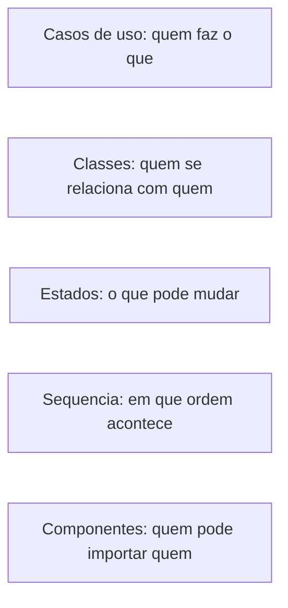

## Mensagem 1 — Usuário

Crie UMLs diferentes para visualizarnos melhor o app, quais voce sugere?

## Mensagem 2 — Assistente

Vou olhar a estrutura do app para sugerir diagramas UML que realmente ajudem a enxergar o domínio, e não um conjunto genérico.

> **Ferramenta:** `Glob` — glob_pattern: **/*.{py,md}

> **Ferramenta:** `Read` — path: README.md

> **Ferramenta:** `Read` — path: docs/arquitetura.md

> **Ferramenta:** `Glob` — glob_pattern: docs/**/*.{md,puml,plantuml,mmd}

> **Ferramenta:** `Grep` — pattern: ^class em domain/

> **Ferramenta:** `Grep` — pattern: ^class em use_cases/

> **Ferramenta:** `Grep` — pattern: rotas HTTP em infra/api/routers/

> **Ferramenta:** `Glob` — glob_pattern: **/*uml*

> **Ferramenta:** `Read` — path: domain/anuncio.py

> **Ferramenta:** `Read` — path: domain/leilao.py

> **Ferramenta:** `Read` — path: domain/venda.py

> **Ferramenta:** `Read` — path: docs/arquitetura.md (trecho de eventos e jobs)

> **Ferramenta:** `Grep` — pattern: UML|diagrama|casos de uso em docs/

## Mensagem 3 — Assistente

O app já descreve atores, estados e camadas em texto, mas não tem diagrama. Vou propor um conjunto curto, cada um respondendo uma pergunta diferente, em Mermaid dentro de `docs/` para renderizar no GitHub.

> **Ferramenta:** `CreatePlan` — Diagramas UML do app

# Diagramas UML do sistema de leilão

Não existe nenhum diagrama no repositório. O que hoje existe é texto e ASCII em README.md e docs/arquitetura.md. Sugiro cinco diagramas, cada um respondendo uma pergunta que os outros não respondem. Formato: Mermaid em Markdown, para renderizar no GitHub sem ferramenta extra.

Branch sugerida (criar só depois da confirmação): `docs/diagramas-uml`.

## O que entra

- **Casos de uso** — o que cada ator faz. Atores reais do README: Vendedor, Comprador e Sistema (jobs). Agrupa RF01–RF13 sem desenhar cada endpoint. Mostra que o Sistema abre/encerra leilão e registra venda sem ação do usuário.
- **Classes do domínio** — como as entidades se ligam, só `domain/` (sem FastAPI nem SQLAlchemy). `Usuario`, `Email`, `Categoria`, `Anuncio`, `Leilao`, `Lance`, `Venda` e os eventos `LanceRealizado` / `LeilaoEncerrado`. Cardinalidades que o código já fixa: anúncio tem no máximo um leilão atual; leilão compõe a lista de lances; venda aponta para anúncio e, quando vem de leilão, para o leilão.
- **Estados** — três máquinas que o ASCII do README junta numa linha só e deixa incompletas:
  - `Leilao`: `AGENDADO` → `ABERTO` → `ENCERRADO` → `PAGO`, ou `ENCERRADO` → `CANCELADO` sem lances
  - `Anuncio`: `ATIVO` → `INATIVO` ou `VENDIDO`; edição só com ativo e sem lances
  - `Venda`: `PENDENTE` → `APROVADO` ou `CANCELADO`
- **Sequência, dois fluxos** — os que a arquitetura destaca e uma classe não mostra:
  - Dar lance: rota → `DarLance` → lock `SELECT FOR UPDATE` → validação no domínio → persistência → evento `LanceRealizado` → auditoria
  - Job de encerramento: APScheduler → `EncerrarLeilao` → vencedor ou cancelado → `LeilaoEncerrado` → `RegistrarVenda` (`PENDENTE`) → depois `SimularPagamento` / `CancelarVenda`
- **Componentes** — a regra de dependência da Clean Architecture: `domain` no centro; `use_cases` depende só dos protocols em use_cases/interfaces.py; `adapters` e `infra` (API, SQLAlchemy, jobs, JWT) apontam para dentro. O ASCII atual em docs/arquitetura.md inverte a leitura das setas.

## O que fica de fora

Diagrama de implantação (Docker, Postgres, Render), diagrama de atividades (repete a sequência) e diagrama de classes da infra (routers, models ORM, schemas). Esses três aumentam o desenho sem esclarecer regra de negócio.

## Onde gravar

Um arquivo por diagrama em `docs/diagramas/`, mais um índice curto. Link na seção “Documentação técnica” do README e um ponteiro no topo de docs/arquitetura.md. Os ASCII de ciclo de vida do leilão permanecem; os diagramas passam a ser a referência visual.

## Mensagem 4 — Usuário

Diagramas UML do sistema de leilão

Implement the plan as specified, it is attached for your reference. Do NOT edit the plan file itself.

To-do's from the plan have already been created. Do not create them again. Mark them as in_progress as you work, starting with the first one. Don't stop until you have completed all the to-dos.

Plano anexado:

# Diagramas UML do sistema de leilão

Não existe nenhum diagrama no repositório. O que hoje existe é texto e ASCII em README.md e docs/arquitetura.md. Sugiro cinco diagramas, cada um respondendo uma pergunta que os outros não respondem. Formato: Mermaid em Markdown, para renderizar no GitHub sem ferramenta extra.

Branch sugerida (criar só depois da confirmação): `docs/diagramas-uml`. Crie a partir dessa atual, dev ainda desatualizada.

## O que entra

- **Casos de uso** — o que cada ator faz. Atores reais do README: Vendedor, Comprador e Sistema (jobs). Agrupa RF01–RF13 sem desenhar cada endpoint. Mostra que o Sistema abre/encerra leilão e registra venda sem ação do usuário.
- **Classes do domínio** — como as entidades se ligam, só `domain/` (sem FastAPI nem SQLAlchemy). `Usuario`, `Email`, `Categoria`, `Anuncio`, `Leilao`, `Lance`, `Venda` e os eventos `LanceRealizado` / `LeilaoEncerrado`. Cardinalidades que o código já fixa: anúncio tem no máximo um leilão atual; leilão compõe a lista de lances; venda aponta para anúncio e, quando vem de leilão, para o leilão.
- **Estados** — três máquinas que o ASCII do README junta numa linha só e deixa incompletas:
  - `Leilao`: `AGENDADO` → `ABERTO` → `ENCERRADO` → `PAGO`, ou `ENCERRADO` → `CANCELADO` sem lances
  - `Anuncio`: `ATIVO` → `INATIVO` ou `VENDIDO`; edição só com ativo e sem lances
  - `Venda`: `PENDENTE` → `APROVADO` ou `CANCELADO`
- **Sequência, dois fluxos** — os que a arquitetura destaca e uma classe não mostra:
  - Dar lance: rota → `DarLance` → lock `SELECT FOR UPDATE` → validação no domínio → persistência → evento `LanceRealizado` → auditoria
  - Job de encerramento: APScheduler → `EncerrarLeilao` → vencedor ou cancelado → `LeilaoEncerrado` → `RegistrarVenda` (`PENDENTE`) → depois `SimularPagamento` / `CancelarVenda`
- **Componentes** — a regra de dependência da Clean Architecture: `domain` no centro; `use_cases` depende só dos protocols em use_cases/interfaces.py; `adapters` e `infra` (API, SQLAlchemy, jobs, JWT) apontam para dentro. O ASCII atual em docs/arquitetura.md inverte a leitura das setas.

## O que fica de fora

Diagrama de implantação (Docker, Postgres, Render), diagrama de atividades (repete a sequência) e diagrama de classes da infra (routers, models ORM, schemas). Esses três aumentam o desenho sem esclarecer regra de negócio.

## Onde gravar

Um arquivo por diagrama em `docs/diagramas/`, mais um índice curto. Link na seção “Documentação técnica” do README e um ponteiro no topo de docs/arquitetura.md. Os ASCII de ciclo de vida do leilão permanecem; os diagramas passam a ser a referência visual.

## Mensagem 5 — Assistente

Vou conferir o domínio e o git para os diagramas baterem com o código, e criar a branch a partir da atual.

> **Ferramenta:** `TodoWrite` — casos de uso em progresso

> **Ferramenta:** `Shell` — git status, branch e log

> **Ferramenta:** `Read` — path: domain/usuario.py

> **Ferramenta:** `Read` — path: domain/lance.py

> **Ferramenta:** `Read` — path: domain/events.py

> **Ferramenta:** `Read` — path: domain/leilao.py (transições)

> **Ferramenta:** `Read` — path: domain/anuncio.py (editar, inativar, vendido)

> **Ferramenta:** `Read` — path: use_cases/dar_lance.py

> **Ferramenta:** `Read` — path: use_cases/encerrar_leilao.py

> **Ferramenta:** `Read` — path: infra/jobs/leiloes.py

> **Ferramenta:** `Read` — path: domain/categoria.py

> **Ferramenta:** `Read` — path: use_cases/interfaces.py

> **Ferramenta:** `Grep` — funções de registrar, publicar e encerrar

> **Ferramenta:** `Read` — path: adapters/events/handlers/lance_realizado_handler.py

> **Ferramenta:** `Read` — path: adapters/events/handlers/leilao_encerrado_handler.py

> **Ferramenta:** `Read` — path: use_cases/registrar_venda.py

> **Ferramenta:** `Read` — path: use_cases/simular_pagamento.py

> **Ferramenta:** `Read` — path: use_cases/cancelar_venda.py

> **Ferramenta:** `Read` — path: infra/api/app.py

> **Ferramenta:** `Read` — path: docs/arquitetura.md (início)

> **Ferramenta:** `Read` — path: README.md (documentação técnica)

> **Ferramenta:** `Grep` — APIRouter prefixes

> **Ferramenta:** `Read` — path: use_cases/iniciar_leilao.py

> **Ferramenta:** `Read` — path: domain/email.py

## Mensagem 6 — Assistente

A árvore está limpa na branch atual. Vou criar `docs/diagramas-uml` a partir dela e começar pelo diagrama de casos de uso.

> **Ferramenta:** `Shell` — git checkout -b docs/diagramas-uml

> **Ferramenta:** `Write` — path: docs/diagramas/casos-de-uso.md

> **Ferramenta:** `Write` — path: docs/diagramas/classes-dominio.md

> **Ferramenta:** `Write` — path: docs/diagramas/estados.md

> **Ferramenta:** `Write` — path: docs/diagramas/sequencia.md

> **Ferramenta:** `Write` — path: docs/diagramas/componentes.md

> **Ferramenta:** `Grep` — imports em infra/db e adapters

> **Ferramenta:** `Read` — path: infra/api/routers/leiloes.py

> **Ferramenta:** `StrReplace` — docs/diagramas/sequencia.md: commit é callback do caso de uso, não método do repositório

> **Ferramenta:** `StrReplace` — docs/diagramas/componentes.md: seta tracejada do repositório para o model ORM

> **Ferramenta:** `StrReplace` — README.md: link para os diagramas

> **Ferramenta:** `StrReplace` — docs/arquitetura.md: ponteiro para os diagramas

> **Ferramenta:** `Write` — path: docs/diagramas/README.md

> **Ferramenta:** `Read` — path: docs/diagramas/componentes.md

> **Ferramenta:** `StrReplace` — docs/diagramas/componentes.md: corrige onde moram models e repositórios

> **Ferramenta:** `Shell` — cinco commits docs na branch docs/diagramas-uml

> **Ferramenta:** `TodoWrite` — os seis itens concluídos

## Mensagem 7 — Assistente

Os cinco diagramas estão na branch `docs/diagramas-uml`, em [`docs/diagramas/`](docs/diagramas/README.md). O índice também está ligado no README e no topo de [`docs/arquitetura.md`](docs/arquitetura.md).

| Diagrama | O que mostra |
|---|---|
| [Casos de uso](docs/diagramas/casos-de-uso.md) | Vendedor, comprador e o job, agrupando RF01–RF13 |
| [Classes](docs/diagramas/classes-dominio.md) | Entidades de `domain/`, com o leilão atual, os lances e a venda |
| [Estados](docs/diagramas/estados.md) | Máquinas de leilão, anúncio e venda |
| [Sequência](docs/diagramas/sequencia.md) | Lance com lock, job de abertura/encerramento e pagamento |
| [Componentes](docs/diagramas/componentes.md) | Quem depende de quem; a seta aponta para dentro |

Dois detalhes do código que o desenho deixa explícitos: `LeilaoEncerrado` só grava auditoria, e a venda `PENDENTE` nasce numa passagem seguinte do mesmo job. A seta tracejada no diagrama de componentes é o repositório em `adapters` importando o model ORM em `infra`.

## Mensagem 8 — Usuário

/exportar-conversas-ia

## Mensagem 9 — Assistente

Para arquivar a transcrição, preciso do autor e do que entra no arquivo. A ferramenta desta sessão é o Cursor.

> **Ferramenta:** `AskQuestion` — autor e escopo

## Mensagem 10 — Usuário

Autor: Caio. Escopo: Conversa atual.
