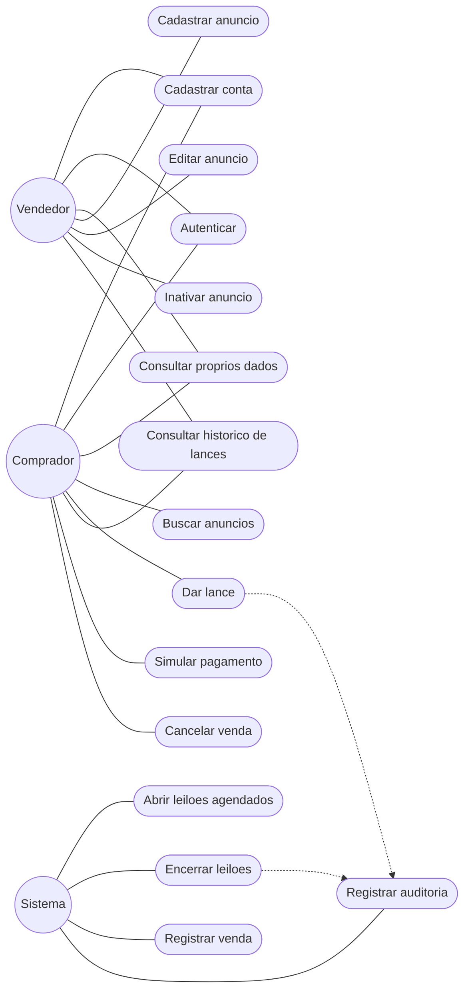

# Casos de uso

Quem faz o quê. Os atores são os do README: **Vendedor**, **Comprador** e **Sistema** (o job periódico, não uma pessoa). Os casos agrupam RF01–RF13; cada elipse não é um endpoint.

A linha tracejada é «include»: o caso de origem sempre dispara o de destino. Cadastro, login e consulta dos próprios dados valem para os dois papéis humanos.

| Caso de uso | Requisito | Quem dispara |
|---|---|---|
| Cadastrar conta | RF01 | Vendedor ou comprador |
| Autenticar | RF02 | Vendedor ou comprador |
| Consultar próprios dados | RF03 | Vendedor ou comprador |
| Cadastrar anúncio | RF04, RF06 | Vendedor. O leilão nasce com preço, incremento e janela |
| Buscar anúncios | RF05 | Comprador |
| Abrir leilões agendados | RF07 | Sistema, no horário de início |
| Dar lance | RF08 | Comprador, só em leilão aberto |
| Consultar histórico de lances | RF09 | Vendedor ou comprador autenticado |
| Encerrar leilões | RF10 | Sistema, ao fim do prazo |
| Registrar auditoria | RF11 | Sistema, depois de um lance aceito ou de um encerramento |
| Editar anúncio / Inativar anúncio | RF12 | Vendedor, só no próprio anúncio |
| Registrar venda | RF13 | Sistema, depois de encerrar com vencedor |
| Simular pagamento / Cancelar venda | RF13 | Comprador que venceu o leilão |

O vendedor acompanha a disputa pelo mesmo histórico de lances. Ele não dá lance no próprio leilão: essa recusa fica na regra de `Leilao.validar_lance`, não num caso de uso separado.
