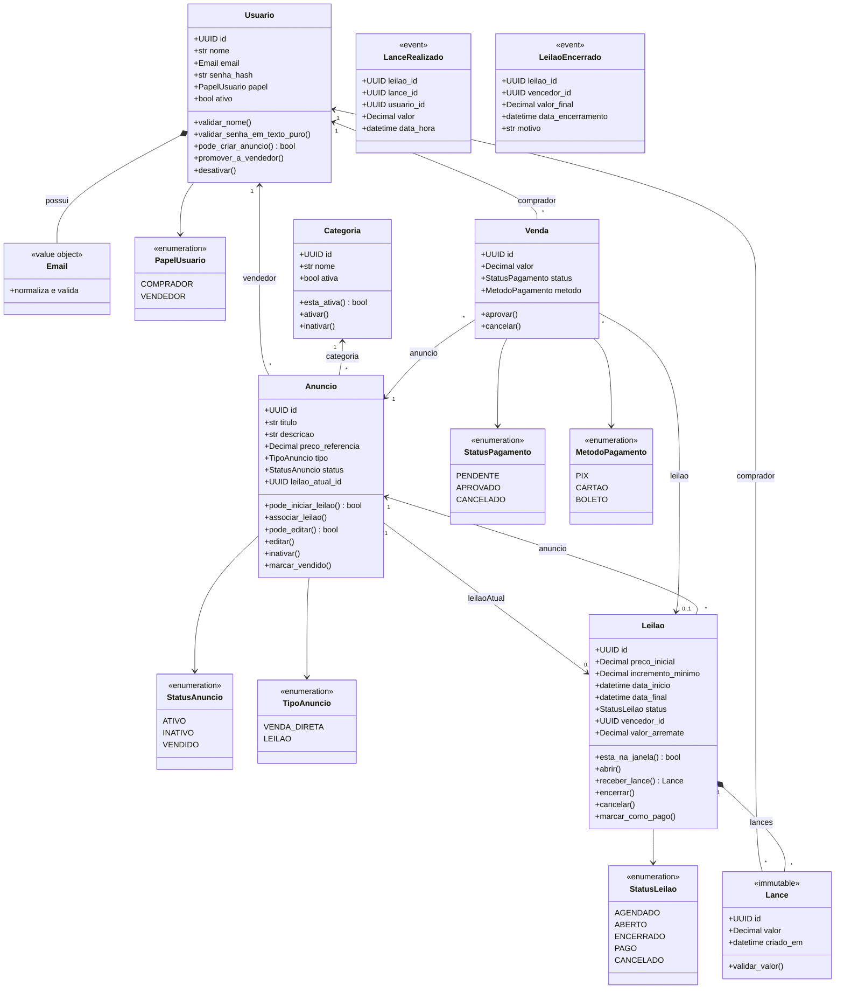

# Classes do domínio

Como as entidades se ligam. Só o que vive em `domain/`: sem FastAPI, sem SQLAlchemy e sem os casos de uso. Setas de associação apontam para o lado que guarda o identificador.

`Anuncio.leilao_atual_id` aponta para no máximo um leilão em curso. Cada `Leilao` guarda o próprio `anuncio_id`, então o mesmo anúncio pode ter leilões anteriores. `Lance` é imutável e só existe dentro da lista do leilão. `Venda` sempre aponta para um anúncio; `leilao_id` fica preenchido quando a venda nasce de um arremate. `LanceRealizado` e `LeilaoEncerrado` são eventos publicados, não registros do agregado.

