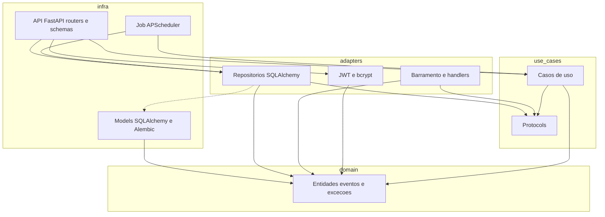

# Componentes

Quem pode importar quem. A seta significa **depende de** e aponta para dentro: a camada de fora conhece a de dentro. `domain` não importa FastAPI, SQLAlchemy, bcrypt nem APScheduler.

Os protocols (`UsuarioRepository`, `LeilaoRepository`, `AnuncioRepository`, `VendaRepository`, `AuditoriaRepository`, `PasswordHasher`) estão em `use_cases/interfaces.py`. Os casos de uso dependem desses contratos. Os repositórios, o bcrypt e o handler de auditoria moram em `adapters` e implementam os contratos. Os models ORM ficam em `infra/db/models`. A API e o job disparam os casos de uso; a regra fica no domínio.

A seta tracejada é a exceção que o código tem hoje: o repositório em `adapters` importa o model ORM em `infra/db/models`. A regra continua valendo para `domain` e `use_cases`, que não importam essa camada.

| Camada | Conhece | Não conhece |
|---|---|---|
| `domain` | a si mesma | casos de uso, adapters, infra |
| `use_cases` | `domain` e os protocols que ela mesma declara | FastAPI, SQLAlchemy, bcrypt, APScheduler |
| `adapters` | `domain`, os protocols e os models ORM | as rotas |
| `infra` | casos de uso, adapters e `domain` | — |

O job em `infra/jobs/leiloes.py` monta o repositório concreto e entrega para `IniciarLeilao`, `EncerrarLeilao` e `RegistrarVenda`. Ele escolhe quais leilões processar. Quem abre, encerra e valida a venda são os casos de uso e as entidades.
