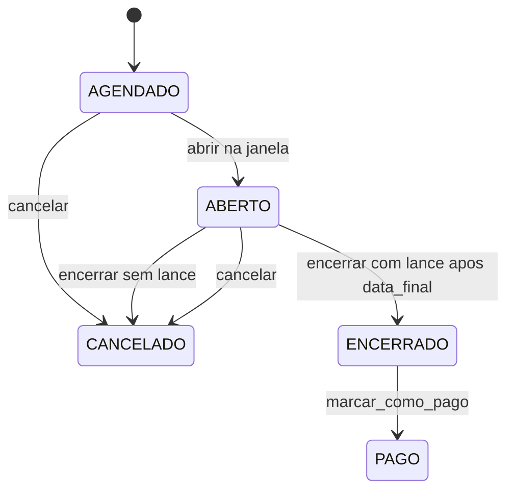
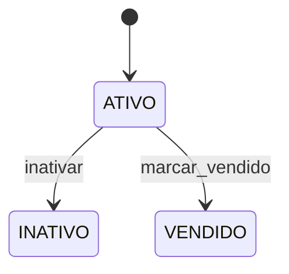
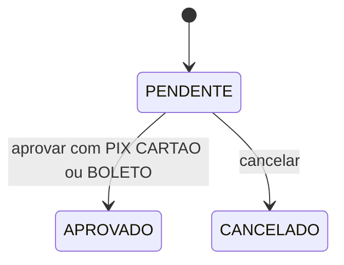

# Máquinas de estado

O que pode mudar. O ASCII do README junta o leilão numa linha só. Aqui cada agregado tem a própria máquina, como o código em `domain/leilao.py`, `domain/anuncio.py` e `domain/venda.py`.

Editar um anúncio não troca o status. `Anuncio.editar` só aceita anúncio `ATIVO` e sem lances no leilão atual.

## Leilão

`encerrar` antes de `data_final` é recusado e o status não muda. Sem nenhum lance, `encerrar` vai para `CANCELADO`. Com lance, vai para `ENCERRADO` e grava vencedor e valor de arremate. `cancelar` vale em `AGENDADO` ou `ABERTO`. `PAGO` só sai de `ENCERRADO`, quando o pagamento da venda é aprovado.

## Anúncio

Não há reativação. Anúncio `VENDIDO` não pode ser inativado. `marcar_vendido` só parte de `ATIVO` e acontece junto com a aprovação do pagamento.

## Venda

A venda nasce `PENDENTE`, sem método. `aprovar` e `cancelar` só valem nesse estado. Cancelar a venda não devolve o leilão para `ABERTO` nem tira o status `ENCERRADO`.

