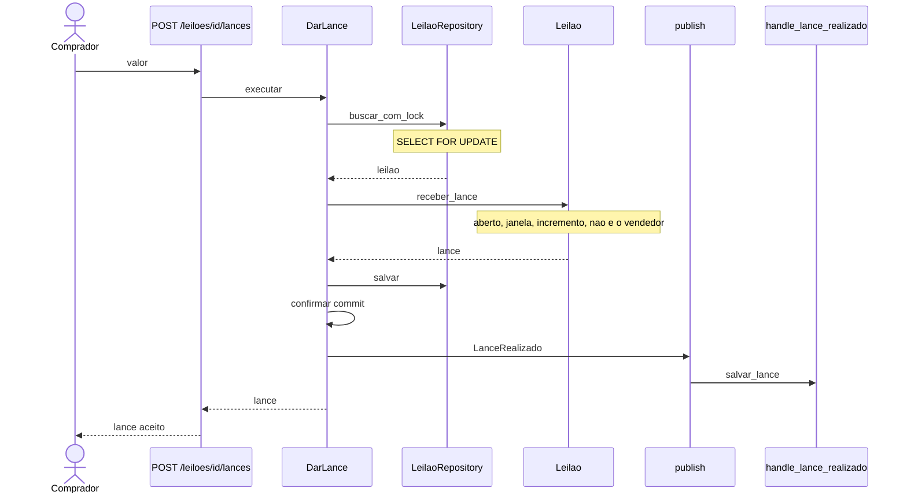
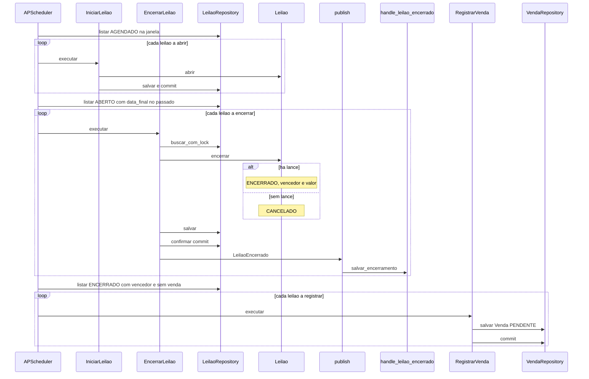
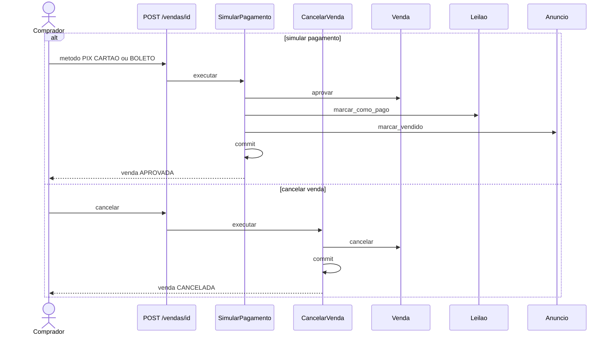

# Sequência

Em que ordem as coisas acontecem. Os dois fluxos que uma classe não mostra: o lance com lock e o job que abre, encerra e registra a venda. O pagamento entra no fim porque é o comprador, não o job, quem o dispara.

`LeilaoEncerrado` não cria a venda. O handler desse evento só grava auditoria. A venda `PENDENTE` nasce numa passagem seguinte do mesmo job, para leilão `ENCERRADO` com vencedor e ainda sem venda.

## Dar lance

`POST /leiloes/{leilao_id}/lances`. O lock pessimista segura o leilão até o commit. A regra (aberto, janela, incremento, vendedor fora) roda dentro dessa transação, em `Leilao.receber_lance`. O evento sai só depois do commit: um rollback não vira lance auditado.

Se o leilão não existe, `DarLance` levanta `LeilaoNaoEncontradoError` antes de chamar o domínio. Se o lance fere a regra, `receber_lance` levanta `LanceInvalidoError` ou `EstadoLeilaoInvalidoError` e nada é commitado.

## Job de leilões

O APScheduler chama `processar_leiloes` a cada minuto. Cada leilão abre ou encerra na própria transação: a falha de um não impede os outros. `IniciarLeilao` não publica evento. `EncerrarLeilao` publica `LeilaoEncerrado` depois do commit, e o handler grava a auditoria. Sem lances, o leilão vai para `CANCELADO` e o motivo do evento é `sem_lances`.

## Pagamento e cancelamento

`POST /vendas/{venda_id}/pagamento` e `POST /vendas/{venda_id}/cancelar`. Só o comprador gravado na venda pode as duas ações, e só enquanto ela está `PENDENTE`.

Aprovar o pagamento muda três agregados na mesma transação: venda `APROVADO`, leilão `PAGO`, anúncio `VENDIDO`. Cancelar muda só a venda. O leilão permanece `ENCERRADO`.

